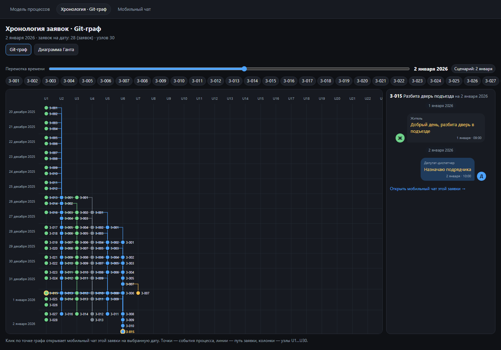

# agencyai — Приёмная депутата

Интерактивная система приёмной депутата: приём и ведение обращений жителей по циклу
**житель → депутат-диспетчер → подрядчик** — роли и права, SLA с паузами и эскалацией,
аудит действий, отчётность. Основа — «раздел 8» регламента: 37 ситуаций и 30 узлов процесса.

**Статус:** сайт опубликован — **https://baskakovanton.github.io/agencyai/** (4 страницы прототипа,
копия байт-в-байт; GitHub Pages, ветка `main`).

## Структура

```
.
├── AGENTS.md      # память проекта: состояние, решения, журнал (агент читает первым)
├── README.md      # этот файл
├── index.html     # обзор: список 37 ситуаций, карточки, степпер (из deput, как есть)
├── process.html   # список по разделам 8.1–8.4 + плеер в модалке (из deput, как есть)
├── player.html    # свимлейн-плеер ситуаций по ролям (из deput, как есть)
├── matrix.html    # матрица «роль × узел процесса» (из deput, как есть)
├── src/           # терминальная модель: core (чистые функции), cli, io, data
├── tests/         # bun test: граф, генератор, навигация, операторский прогон
├── package.json   # скрипты bun (start, demo, test)
├── tsconfig.json  # strict TypeScript
├── assets/        # общие ресурсы (CSS/JS), когда понадобятся
└── docs/          # документы: ТЗ, регламент, принятые решения
```

## Что уже решено

| Вопрос | Решение |
|---|---|
| Суть | Продукт «Приёмная депутата» — рабочая система учёта обращений |
| Источник данных | Прототип [goshva/deput](https://github.com/goshva/deput), перенесён **как есть** |
| Свой текст регламента | Нет; deput — единственный источник данных |
| Согласие автора | `goshva` — коллега, перенос согласован |
| Публикация | ✔ GitHub Pages, публично: репозиторий публичный, сайт раздаётся из `main` |
| Шаг 1 | ✔ README + каркас папок |
| Шаг 2 | ✔ Перенос 4 страниц прототипа |

## Модель (из прототипа)

- **7 ролей:** житель, депутат-диспетчер, помощник, подрядчик, система (авто), наблюдатель, аудитор.
- **30 узлов процесса** (U1…U30) в 6 группах: приём, исполнение, управление, закрытие, просмотр, особые.
- **37 ситуаций** (С1…С37): 8.1 До принятия — 8, 8.2 В работе — 20, 8.3 Подрядчики — 5, 8.4 Отчётность — 4.
  Перенесены в модель скриптом `scripts/import-situations.ts`: у каждой ситуации есть приоритет, текст
  норматива, шаги по ролям и связь с узлами процесса; каждая заявка «проигрывает» одну из ситуаций.
- **Уровни доступа роли к узлу:** `✓` может · `⊂` только в своём · `!` при условии · `✕` запрещено · `—` не участвует.
- **Права проверяются при переходах:** `allow/subset/conditional` — можно, `deny/na` — нельзя; чьи права
  учитываются, задаёт роль оператора (`role` в терминале, переключатель на странице). `U30 «Удаление»`
  запрещён всем семи ролям, поэтому процесс архивируется на `U29`.
- **SLA — это состояние:** норматив по приоритету (авария 1/24 ч, неотложное 24/72 ч, сезонное до 720 ч),
  пауза (погода, нет доступа, согласования, финансы) и возобновление со сдвигом дедлайна, пересчёт после
  уточнения (U2), фиксация просрочки и однократная эскалация. Время двигают шаги процесса и команда `wait`.
- **Аварии** (С9, С10) идут вне очереди: сначала звонок, регистрация параллельно.

## Терминальная модель процессов (bun + TypeScript)

Модель процессов без интерфейса: генерирует заявки по инцидентам городской инфраструктуры,
ставит их на узлы процесса и позволяет пошагово двигать вперёд/назад (в том числе оператору).

```bash
bun test                              # unit- и функциональные тесты
bun run src/cli/main.ts               # интерактивный режим оператора
bun run src/cli/main.ts --auto 12     # автопрогон: 12 массовых шагов
bun run src/cli/main.ts --script "graph;list;forward З-005;save"
```

Процесс — с **развилками и весами** (U4 → U5/U6, U9 → U6/U16/U10, U12 → U13/U19, U13 → U10/U6/U14):
часть переходов выбирается случайно, `back` симметричен, на U12/U13 возможен цикл переделки.

Команды оператора: `graph`, `node U7`, `list`, `show З-001`, `forward З-001`, `back З-001`,
`move З-001 U9`, `role contractor`, `wait 24`, `situations`, `situation С9`, `sweep`, `report`, `save`,
`help`, `quit`.
Ссылка на заявку понимает любой ввод: `5`, `З-5`, `z-5`, `Z-005` — можно не переключать раскладку.

Устройство: `src/core` — чистые функции без обращений к среде (граф, генератор инцидентов,
навигация, отчёт), `src/cli` — операторский цикл, `src/io` — **единственное** место записи на диск
(`reports/`: отчёт и финальное состояние). Состояние живёт в оперативной памяти, что соответствует
спеке и позволит позже собрать ядро в бандл для демо на GitHub Pages.

## Демо с логикой модели (GitHub Pages)

**https://baskakovanton.github.io/agencyai/demo/** — вся логика запечена в один `app.js` (≈72 КБ):
30 узлов, генератор инцидентов, переходы по соседним узлам, отчёт. Ни сети, ни сервера, ни внешних
зависимостей; параметр `?seed=7` меняет генерацию.

```bash
bun run scripts/build-web.ts demo   # Bun.build → demo/app.js + demo/index.html + demo/style.css
bun test                            # 155 тестов, включая паритет «страница = ядро»
```

Локально страницу нужно поднимать статикой (`python -m http.server 8080` в папке `demo`),
потому что ES-модули не загружаются по `file://`.

## Демо: хронология заявок (Git-граф) и мобильный чат

Демо — это два связанных экрана, состояние между ними передаётся через адрес (`?at=<дата>`):

| Экран | Адрес | Что показывает |
|---|---|---|
| **Хронология · Git-граф** | `demo/#timeline` | Колонки — узлы U1…U30, строки — дни, точки — события («коммиты») заявок, линии — путь заявки по процессу. Над графом — **шкала времени** (24 часа выбранного дня, маркер текущего «сейчас», клик по дню перематывает дату) и **легенды**: четыре фазы SLA и значки развилки/слияния. **Ползунок времени** скрывает будущее, кнопка «Сценарий: 2 января» ставит дату из ТЗ. **Клик по коммиту открывает карточку узла** (заявка, узел, ответственный, время в узле, SLA, ситуация) со ссылкой в чат. Переключатель **«Диаграмма Ганта»** — те же данные полосами, цвет полосы = фаза SLA. Рядом компактный чат, синхронный по дате |
| **Мобильный чат** | `demo/#chat/З-015?at=2026-01-02` | Макет телефона: пузыри сообщений, аватары ролей, время, разделители дней. Шапка красится в цвет активной роли, бейдж SLA показывает фазу. Переписка строится по узлам: U1 — житель, U6 — депутат-диспетчер, U7 — подрядчик, U19 — снова житель; при смене узла приходит **системное сообщение** и меняются роль и собеседник. Кнопки «Реплика назад/вперёд» и «Сменить роль». **Полей ввода нет** — это плеер переписки |

Сценарий «2 января» из ТЗ: открыть демо → ползунком уйти на 2 января (или кнопкой сценария) → граф
перерисовывается, видны только существовавшие заявки с обрезанными ветками → клик по любой видимой заявке
открывает её чат, где видны только сообщения до этой даты → «Сменить роль» показывает ту же переписку глазами
другого участника.




Технически: даты — поля `createdAt` и `Move.at`, история раскручивается чистыми функциями
`src/core/timeline.ts` и `src/core/story.ts` (30 заявок, шаг ≈ сутки, герой З-015 — по маршруту из ТЗ);
Git-граф и Гант — `src/core/gitgraph.ts` и `src/core/gantt.ts`, разметка — `src/web/git-svg.ts` и
`src/web/gantt-grid.ts`; переписка — `src/core/conversation.ts` и тексты `src/data/messages.ts`;
e2e-сценарии — Playwright (21 проверка), CI — `.github/workflows/e2e.yml`.
План: [docs/gitgraph-plan.md](docs/gitgraph-plan.md).

```bash
bun test                 # 155 юнит- и функциональных тестов
bun run build:demo       # пересборка demo/app.js
bun run serve:demo       # статика на http://127.0.0.1:4321
bun run e2e              # 21 сценарий Playwright (chromium): модель, хронология, чат
bun run screenshots      # свежие скриншоты в docs/screenshots/
```

Примечание: таблица когорт срочности убрана — по ТЗ её место занимают развилки процесса. Файла
«agencyai · модель процессов.txt» в системе нет, поэтому данные берутся из нашей модели (30 заявок, 30 узлов,
приоритеты из ситуаций регламента).
## Как посмотреть локально

Откройте `index.html` в браузере. Сборка и интернет не нужны: CSS и JS встроены в страницы,
внешних зависимостей нет.

## Деплой

Сайт раздаётся через GitHub Pages: **https://baskakovanton.github.io/agencyai/** — ветка `main`, корень
репозитория, HTTPS принудительно. Любой push в `main` пересобирает сайт автоматически.

На бесплатном плане GitHub Pages не работает для приватных репозиториев (`422`), поэтому репозиторий
сделан публичным. Если код понадобится закрыть — переезд на внешний хостинг (Vercel / Netlify /
Cloudflare Pages / Amvera) либо возврат в приватный режим без Pages.

## Дорожная карта

1. ✔ README + каркас папок
2. ✔ Перенести 4 страницы прототипа как есть (копия байт-в-байт)
3. ✔ Включить GitHub Pages — https://baskakovanton.github.io/agencyai/
4. ✔ Терминальная модель процессов (bun + TypeScript, 30 узлов из `deput`, 24 теста)
5. ✔ Демо-сборка с логикой модели — https://baskakovanton.github.io/agencyai/demo/
6. ✔ Ветвления графа и рандомные решения (U4, U9, U12, U13 — веса и цикл переделки)
7. ✔ Роли в переходах: права проверяются, `U30` недоступен никому
8. ✔ SLA как состояние: нормативы, паузы, пересчёт, просрочка и эскалация
9. ✔ 37 ситуаций `deput` перенесены (шаги, приоритеты, SLA, связь с узлами)
10. ✔ Демо-модули: дашборд когорт и чат по ролям (снято 16.11.2026 — заменено хронологией)
11. ✔ Git-граф заявок с перемоткой времени, Гант-fallback и мобильный чат, синхронный по дате
12. ✔ Шкала времени и легенды SLA/развилок, карточка узла по клику, SLA-цвета и роли в чате
13. Дальше: продуктовый слой (реальные обращения, хранение, авторизация)

## Происхождение

Модель процессов и интерфейсные решения взяты из публичного прототипа
[goshva/deput](https://github.com/goshva/deput); файлы перенесены как есть с согласия автора (коллега).
